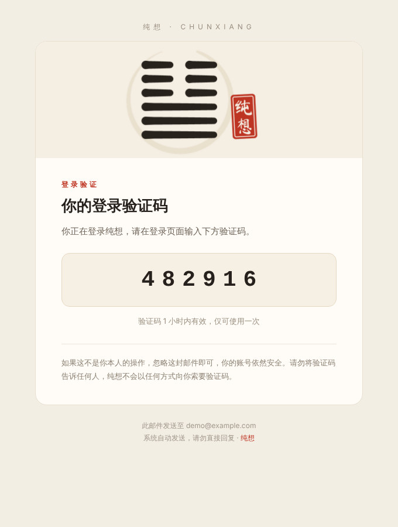

# Supabase 验证码邮件模板（纯想风格）

宣纸底、墨色字、朱砂印。头图是一张循环动图：泰卦六爻自下而上逐笔写成，最后落下"纯想"朱砂印。



| 文件 | 说明 |
| --- | --- |
| `templates/magic_link.html` | 登录验证码（Supabase 的 **Magic Link** 模板，邮箱 OTP 登录也用它） |
| `templates/confirmation.html` | 注册验证码（**Confirm signup** 模板） |
| `templates/reauthentication.html` | 敏感操作验证码（**Reauthentication** 模板） |
| `auth-config.json` | 上面三个模板加邮件标题，可直接作为 Management API 的请求体 |
| `assets/header.gif` | 头图动画，1120×400（2 倍图），约 140KB |
| `build.py` | 生成以上全部文件 |

## 应用到 Supabase

邮件模板由 Supabase Auth 渲染，接了 AWS SES 自定义 SMTP 也一样在 Supabase 里配置。

**方式一：Dashboard 粘贴**

Authentication → Email Templates，分别打开 Magic Link / Confirm signup / Reauthentication，把对应 HTML 整个粘进去，标题填：

| 模板 | Subject |
| --- | --- |
| Magic Link | `{{ .Token }} 是你的纯想登录验证码` |
| Confirm signup | `{{ .Token }} 是你的纯想注册验证码` |
| Reauthentication | `{{ .Token }} 是你的纯想安全验证码` |

**方式二：Management API 一次性更新**

```bash
# Access token 在 https://supabase.com/dashboard/account/tokens 生成
export SUPABASE_ACCESS_TOKEN=...
export PROJECT_REF=...   # 项目 ref，即 <ref>.supabase.co 的前缀

curl -X PATCH "https://api.supabase.com/v1/projects/$PROJECT_REF/config/auth" \
  -H "Authorization: Bearer $SUPABASE_ACCESS_TOKEN" \
  -H "Content-Type: application/json" \
  --data-binary @supabase/email/auth-config.json
```

## 注意事项

- **只发验证码，不带链接。** 模板里只有 `{{ .Token }}`，没有 `{{ .ConfirmationURL }}`，所以前端需要让用户输入验证码，再调用
  `supabase.auth.verifyOtp({ email, token, type: 'email' })`。这样也能避免企业邮箱的安全扫描提前"点开"链接导致验证码失效。
- **有效期文案**写的是"1 小时"，对应 Authentication → Providers → Email → Email OTP Expiration 的默认值 3600 秒。改了这个配置的话，同步修改 `build.py` 里的 `OTP_EXPIRY` 并重新生成。
- **头图地址**默认指向 jsDelivr 上 `main` 分支的 `assets/header.gif`，合并到 `main` 之后才能访问。jsDelivr 在国内不太稳定，国内用户多的话，建议把 GIF 上传到 Supabase Storage 的公开 bucket 或阿里云 OSS，再生成一次模板：

  ```bash
  python supabase/email/build.py --asset-url https://<ref>.supabase.co/storage/v1/object/public/email/header.gif
  ```

- Outlook 桌面版只显示 GIF 第一帧，所以第一帧就是完整画面；邮件客户端不加载图片时会显示 alt 文字，验证码本身是文字，不受影响。
- 系统支持深色模式时（Apple Mail、Outlook.com 等），卡片会自动切换成深色。

## 修改与重新生成

文案、配色、有效期都在 `build.py` 顶部。只生成模板时不需要第三方依赖：

```bash
python supabase/email/build.py
```

重新生成动图需要 Pillow 和印章字体（推荐 Google Fonts 的 [Ma Shan Zheng](https://fonts.google.com/specimen/Ma+Shan+Zheng)，OFL 授权）：

```bash
pip install pillow
python supabase/email/build.py --gif --seal-font MaShanZheng-Regular.ttf
```
